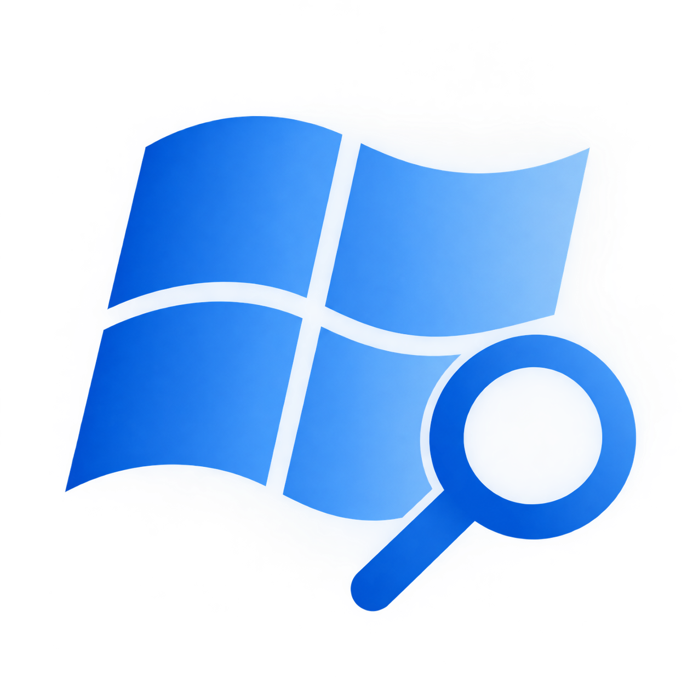

    

   # ProcessMonitor Documentation

## Navigation

You can navigate through the documentation by following one of the three subgroups: 

- [**_Tasks_**](./Tasks/README.md)
  - Formalizes the tasks which need to be accomplished or the ones which are already completed.

- [**_Projects_**](./Projects/ProcessMonitor.Backend/README.md)
  - Provides overviews on the architecture for each project (currently only for the server)

- [**_Protocols_**](./Protocols/README.md)
  - Explains custom application layer OSI protocols for the named pipes based IPC communication  

- [**_Manual (Not implemented)_**](./Manual/README.md)
  - Provides concrete descriptions for types and their members.

## Deprecation

For a while, the development of this project has been stopped since the basics were implemented
and the code had to go through a lot of refactoring to become more maintanable.

In that context, while studying further, I realized that the project has become very difficult
to develop. As the codebase grew, the problems became visible. Here is the summary of all the issues:

- Architecture was not designed properly
  - Everything in the codebase existed in a single layer without proper distribution of 
  responsibilities. The services had tightly coupled dependencies making testing hard
  to develop. The solution: enfore Clean Architecture rules for the rewrite

- ASP.NET Core reinvention
  - The more code I wrote, the more I realized that it highly resembles the Minimal Api of
  ASP.NET Core except there was no configuration, authentication/authorization system. 
  The solution: add ASP.NET Core to the project and configure it to listen to NPFS via gRPC

- Unnecessity of certain utilities
  - The last refactoring went over the switch from the Exception based return values to the
  custom Result type that carries the accumulated application state allowing a convenient
  single operation handling of the errors/warnings when logging. But this refactoring was
  taking a lot of unnecessary time pausing the development. Furthermore, instead of using
  the custom implementations, the already written nuget packages could've been utilized.
  The solution: use one of the Result type libraries to avoid refactor rabbithole

- Custom scripting language
  - The time was partially also distributed for writing custom script handling code aka
  the PMQL. It is very simple by itself. A single command parser. But it was planned to
  make the system more robust in the final release including the query language being
  capable of handling conditional execution and custom function definitions. Therefore,
  the PMQL would require a lot of time just for a console interface that is considered
  a fallback interface (desktop is the default one). The solution: get rid of the PMQL 
  idea completely and use an already created scripting language alongside a .NET library
  that can handle it conveniently: Python, Lua or JavaScript

- The WPF implementation was junky
  - Not that much time or effort was invested in learning WPF which led to the code being
  a mess without a predefined structure. The solution: invest more time in WPF

From now on, this branch is no longer going to be supported. The development was heading
in the wrong direction right from the start. Instead, the project will be rewritten from
scratch. The console project will be ditched away completely to reduce the time span. A
new branch called 'proto' will be created for writing the prototype of this app. Once
all these problems mentioned above are solved, the new branch will be created afterwards
called 'dev' to make the prototype more robust. 

This branch is not going to be kept as a reminder of how the project used to look like. 
